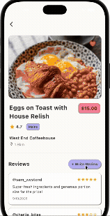
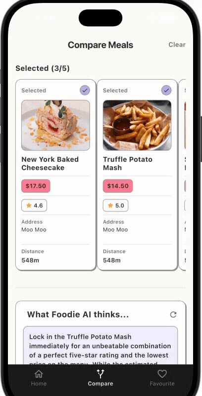
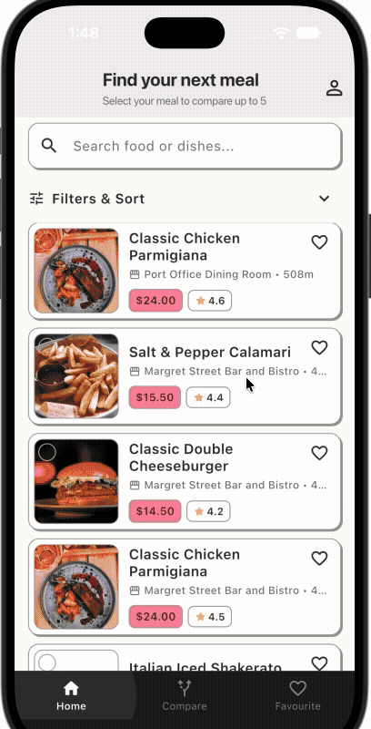
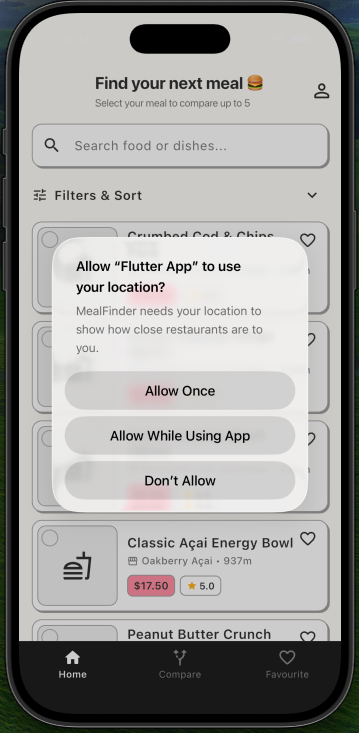

# Meal Finder - Find Your Next Meal

## Work in progress 

  
  
   
  
  

## Overview - Why I'm building this 
Have you ever wanted to eat out but couldn't decide what to order or where to go? You might know that a restaurant has great reviews overall, but that doesn't always mean they have the best version of the dish you're looking for. This app helps you find your next best meal based on what you want to eat and your budget, not simply the highest-rated restaurant. For example, if you're craving ramen and have a budget of $20–$30, you can compare ramen from different restaurants and find the best option for you based on ratings, price, distance, and reviews.

## Tech Stack
- Backend: Python FastAPI
- Authentication: JWT
- Database: PostgreSQL, Alembic, Cloudflare R2 for image storage
- Testing: Pytest
- Frontend: Dart Flutter for mobile app
- Web Admin: Vue 3, Tailwind CSS (in progress)

## Features 
- User authentication, change password, forgot password, reset password
- User upload profile picture
- Add a review for a dish, and edit or delete their own reviews
- Toggle favourite dishes
- Search, filter and sort dishes based on price, rating, distance, food category
- Dish details, including reviews and average rating
- Compare dishes with the help of the Gemini API 

## Challenges/ what I've learnt
- Design the feature to help user compare the options
- Layout of each feature and data model that is suitable for this use case. 
- The fun is when you translate vague ideas to concrete output.

## What's next
- A web admin panel
